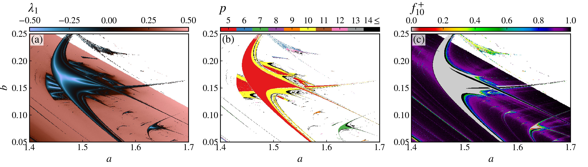
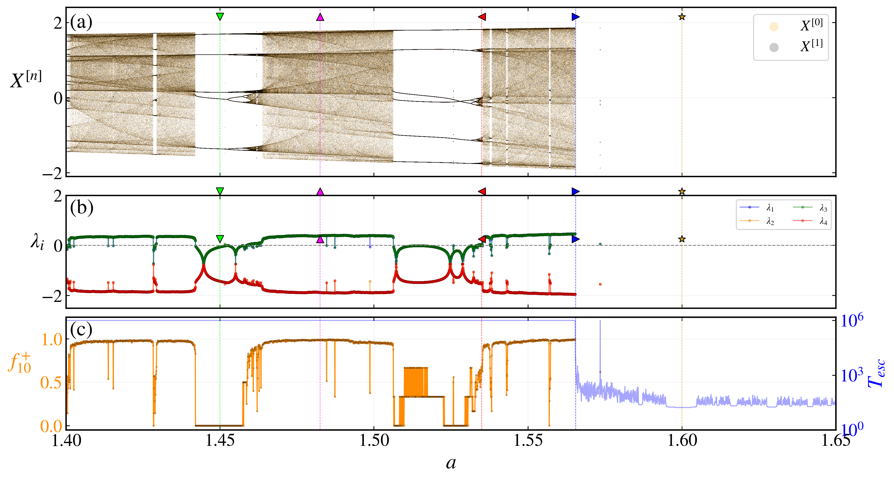
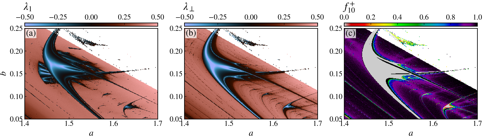
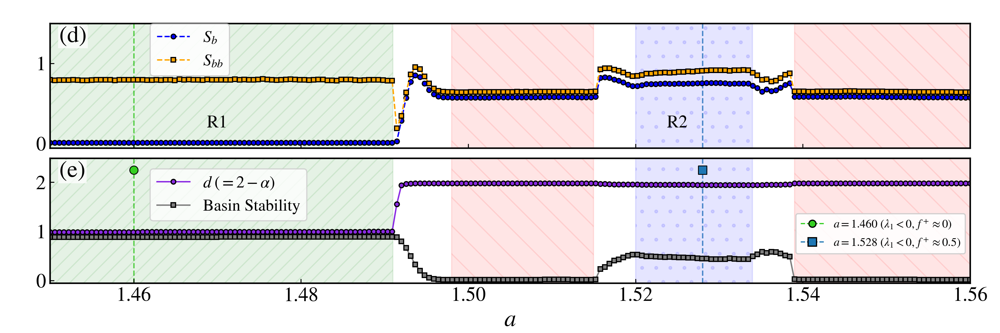
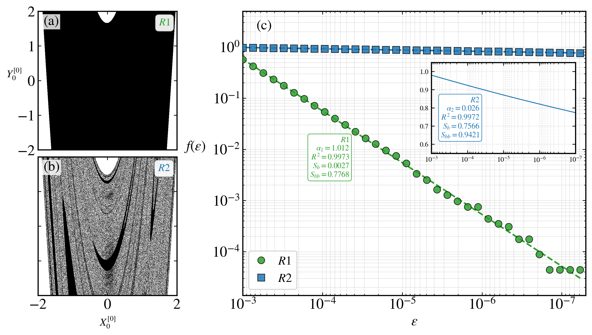

# Beyond the largest lyapunov exponent: characterizing periodic attractor robustness and crisis dynamics in coupled Hénon maps

This repository contains the scripts and numerical simulation code used in the study of the robustness of periodic attractors in coupled nonlinear systems. The main focus is to investigate the limitations of the **largest Lyapunov exponent** in characterizing dynamics at crisis boundaries.

**Key Features:**
*   **Model:** Implementation of two symmetrically coupled Hénon maps.
*   **Implemented Analyses:**
    *   Calculation of **Finite Time Lyapunov Exponents** (largest and transversal).
    *   **Periodicity** detection and **escape time** statistics.
    *   Calculation of **Basin Stability** and **Basins entropies**.
    *   Estimation of **uncertainty exponent** and **analysis of basin geometry**.
*   **Objective:** To reproduce the results demonstrating how periodic structures embedded in crisis regions exhibit severe loss of predictability, requiring metrics beyond the standard Lyapunov exponent.


**How to Cite:**
If you use this code in your research, please cite the associated article:
*[Insert Full Article Reference Here]*

## **License:**
This project is licensed under the **MIT** license. Feel free to use, modify, and distribute the code.

MIT License

Copyright (c) 2026 Conrado Ferreira Bittencourt

Permission is hereby granted, free of charge, to any person obtaining a copy
of this software and associated documentation files (the "Software"), to deal
in the Software without restriction, including without limitation the rights
to use, copy, modify, merge, publish, distribute, sublicense, and/or sell
copies of the Software, and to permit persons to whom the Software is
furnished to do so, subject to the following conditions:

The above copyright notice and this permission notice shall be included in all
copies or substantial portions of the Software.

THE SOFTWARE IS PROVIDED "AS IS", WITHOUT WARRANTY OF ANY KIND, EXPRESS OR
IMPLIED, INCLUDING BUT NOT LIMITED TO THE WARRANTIES OF MERCHANTABILITY,
FITNESS FOR A PARTICULAR PURPOSE AND NONINFRINGEMENT. IN NO EVENT SHALL THE
AUTHORS OR COPYRIGHT HOLDERS BE LIABLE FOR ANY CLAIM, DAMAGES OR OTHER
LIABILITY, WHETHER IN AN ACTION OF CONTRACT, TORT OR OTHERWISE, ARISING FROM,
OUT OF OR IN CONNECTION WITH THE SOFTWARE OR THE USE OR OTHER DEALINGS IN THE
SOFTWARE.


## Environment Setup and Configuration

To ensure the reproducibility of the simulations, this repository includes the `environment.yml` file, which defines all necessary dependencies. Follow the steps below to clone the repository and set up the environment:

1.  **Clone the repository:**
    ```bash
    git clone https://github.com/ConradBitt/beyond-lyapunov-exponent.git
    cd beyond-lyapunov-exponent
    ```

2.  **Create the Conda environment:**
    Run the following command to create an isolated environment and install the listed dependencies:
    ```bash
    conda env create -f environment.yml
    ```

3.  **Activate the environment:**
    ```bash
    conda activate beyond-lyapunov
    ```

4.  **Execution:**
    With the environment active, the simulation and analysis scripts are ready to run.

If you need to update the environment after making changes to the YAML file, use the command `conda env update -f environment.yml --prune`.


## **Scripts and Figures**

The repository already includes the main scripts and rendered outputs used throughout the study. The gallery below highlights the most representative figures and provides a short visual guide to the analysis pipeline.

### 1. Global parameter-space overview



*Figure 1. Parameter-space overview for the coupled Hénon maps at fixed coupling strength with outside syncronization manifold. The panel combines the largest Lyapunov exponent, orbit period, and a fraction positive of transversal lyapunov exponent.*

### 2. Parameter space with dynamical metrics



*Figure 2. Compact summary of the parameter region for $b=0.225$ enriched. The figure emphasizes how periodic windows, escape regions, and the three representative regimes evolve together as the control parameter changes.*

### 3. Parameter-space scan of stability indicators



*Figure 3. Two-dimensional scan over the control parameters showing the largest Lyapunov exponent, transversal Lyapunov exponent, and the fraction of positive finite-time transversal exponents. This panel is useful for locating regions where global stability and transverse instability coexist.*

### 4. Basin entropy and uncertainty exponent



*Figure 4. Basin entropy, boundary entropy, fractal dimension, and basin stability computed as the control parameter varies. The highlighted regimes R1 and R2 summarize the contrast between regular periodic behavior at two different regions.*

### 5. Representative basin geometries



*Figure 5. Representative basin geometries for the three dynamical regimes together with the uncertainty-exponent fits. The left panels show the basins themselves, while the right panel compares the scaling of the uncertain fraction across the regimes.*

Additional basin snapshots are available in [`figures/basins/`](figures/basins/), including the parameter values `a = 1.4600` and `a = 1.5250`.
